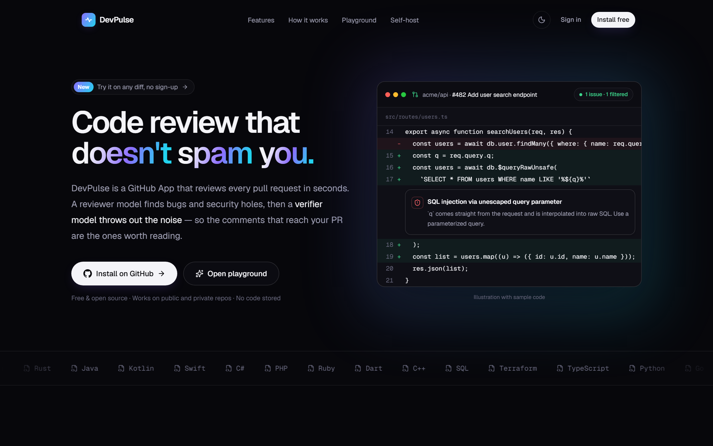
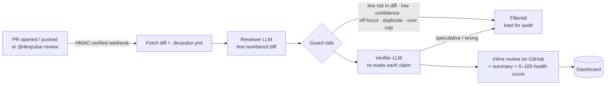
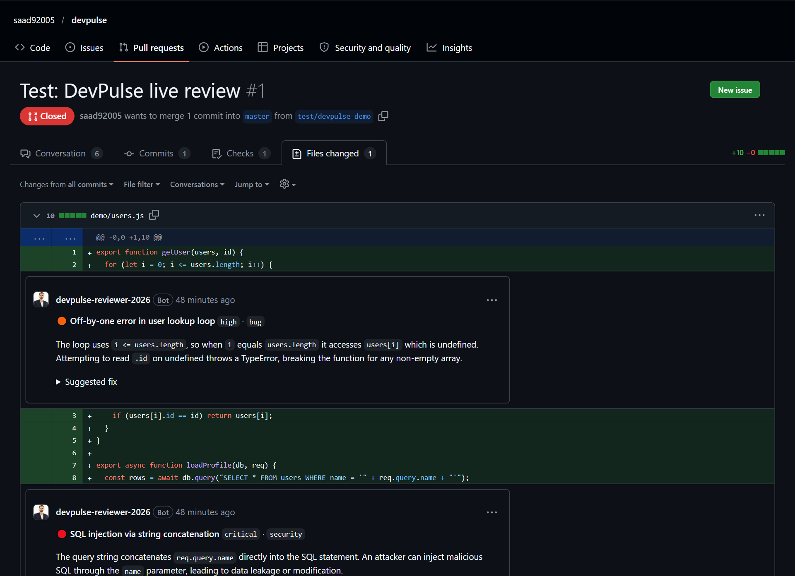
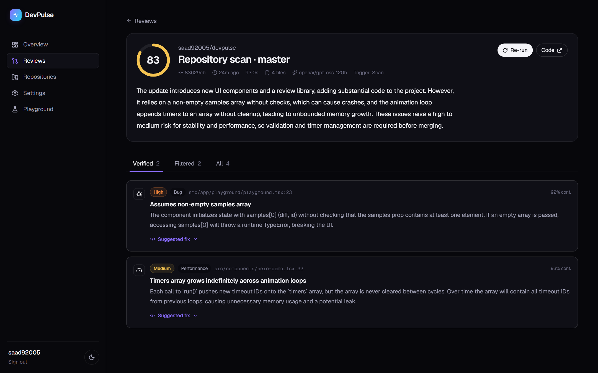
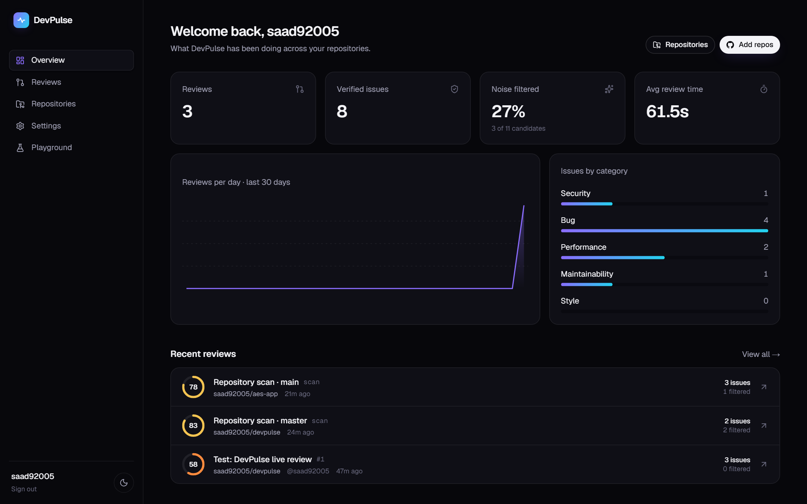
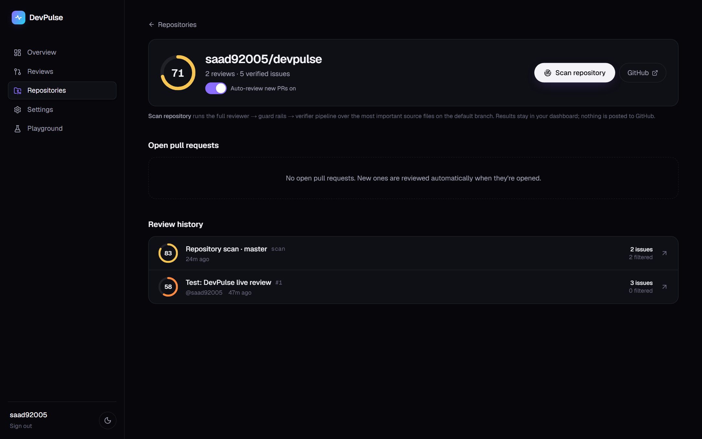

<div align="center">

# ⚡ DevPulse

**AI code review that doesn't spam you.**

A GitHub App that reviews every pull request in seconds. A reviewer model proposes issues, then deterministic guard rails and a second *verifier* model throw out the noise, so only verified findings reach your PR.

[**Live demo**](https://devpulse-ruby.vercel.app) · [**Install on GitHub**](https://github.com/apps/devpulse-reviewer-2026) · [**Try the playground**](https://devpulse-ruby.vercel.app/playground) · [**Example review**](https://github.com/saad92005/devpulse/pull/1/files)




</div>

## The problem

AI review bots are easy to build and hard to trust. Most of them post a wall of speculative comments, and developers learn to ignore them, which also buries the one real bug. DevPulse is built around **precision**: a finding only gets posted if it survives three independent filters.

## How it works



1. **Reviewer.** Reads the diff with explicit new-file line numbers and proposes findings, each with a severity, category, confidence and suggested fix.
2. **Guard rails** (deterministic code, not AI). These reject findings that point at lines the PR didn't add, that fall below the repo's confidence floor, that are outside its focus, that duplicate another finding, or that go over the comment cap.
3. **Verifier.** A second, skeptical prompt re-checks every surviving claim against the code excerpt. It can reject a finding or *downgrade* its severity, but never escalate it.
4. **Post.** Everything goes out as one GitHub review with inline comments, a summary and a health score. Rejected findings are stored too, with the reason and the stage that rejected them, so the filtering is fully auditable.

## Benchmark

Real pipeline runs on seeded-bug diffs (`npm run benchmark`, model `openai/gpt-oss-120b`):

| Metric | Result |
|---|---|
| Seeded bugs caught (recall) | **8 / 9 (89%)** |
| False positives on a clean diff | **0** |
| Average time per review | ~9 s |

Full table in [BENCHMARK.md](BENCHMARK.md).

## Screenshots

| Inline review on a real PR | Repository scan |
|---|---|
|  |  |
| **Dashboard** | **Repository page** |
|  |  |

## Features

- **Automatic PR reviews** on `opened`, `synchronize`, `reopened` and `ready_for_review`. The webhook is HMAC-verified and answers GitHub instantly; the review runs in the background with `after()`.
- **ChatOps:** comment `@devpulse review` on any PR to re-run it.
- **Repository scan:** audit the most important source files on the default branch from the dashboard, using the same reviewer → guard rails → verifier pipeline.
- **On-demand review** of any open PR from the dashboard.
- **Per-repo config** in `.devpulse.yml`, read from the *base* branch so a PR can't weaken its own review.
- **Dashboard:** stats, a 30-day activity chart, issues by category, per-repo health, and a review detail page with Verified / Filtered tabs and live progress.
- **Public playground:** paste any diff and get a review. No sign-up; rate-limited per IP.
- **Multi-tenant:** GitHub OAuth login, and every query is scoped to the installations the user belongs to.
- **Free-tier friendly:** works with any OpenAI-compatible endpoint, and waits for rate-limit buckets to refill instead of failing.

### `.devpulse.yml`

```yaml
strictness: balanced        # relaxed | balanced | strict  (confidence floor 0.8 / 0.65 / 0.5)
max_comments: 10
focus: [bug, security, performance, maintainability]
ignore: ["**/*.test.ts", "docs/**"]
review_drafts: false
language: English
instructions: |
  We use zod for all input validation. Flag handlers that skip it.
```

## Tech stack

| Layer | Tech |
|---|---|
| App | Next.js 16 (App Router, Cache Components, Server Actions, `after()`), React 19, TypeScript |
| UI | Tailwind CSS 4, Motion, Lenis smooth scroll, light/dark themes |
| GitHub | GitHub App (webhooks + installation tokens) via Octokit, OAuth login, JWT session cookie (jose) |
| AI | Groq `openai/gpt-oss-120b` through an OpenAI-compatible client with JSON mode and retries |
| Data | Neon serverless Postgres |
| Quality | Vitest unit tests (diff parser, config, signature check, guard rails with a mocked LLM), benchmark script |
| Hosting | Vercel |

## Run it yourself

```bash
git clone https://github.com/saad92005/devpulse && cd devpulse
npm install
cp .env.example .env.local     # the /setup page shows a live checklist of what's missing
npm run db:migrate
npm run dev
```

You'll need a free [Groq](https://console.groq.com) key, a [Neon](https://neon.tech) database and your own GitHub App with these settings:

- **Permissions:** Pull requests R/W, Issues R/W, Contents R, Metadata R
- **Events:** Pull request, Issue comment
- **Webhook URL:** `<your-url>/api/webhooks/github`
- **Callback URL:** `<your-url>/api/auth/callback`

For local webhooks, use a tunnel such as `smee.io` or `cloudflared`.

| Command | What it does |
|---|---|
| `npm test` | Unit tests |
| `npm run benchmark [runs]` | Runs the real pipeline on seeded-bug samples and writes `BENCHMARK.md` |
| `npm run db:migrate` | Applies `db/schema.sql` |

## Privacy

Diffs and source files are fetched, sent to the model and discarded. Only findings and review metadata are stored.

## Author

Built by **Saad Shahid** · [Portfolio](https://saadshahid-portfolio.vercel.app) · [GitHub](https://github.com/saad92005)
